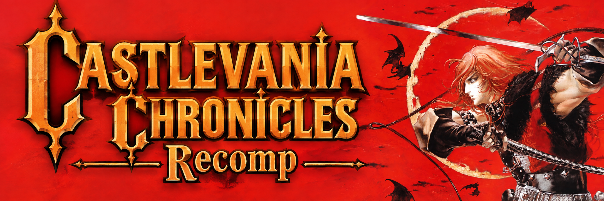

<p align="center">
  
</p>

<p align="center">
  A desktop recompilation of Castlevania Chronicles for Windows, macOS and Linux.<br>
  <strong>Bring your own USA disc. Choose it in the launcher. Press Play.</strong>
</p>

<p align="center">
  <a href="https://github.com/Spicywonda/castlevania-chronicles-recomp/releases/tag/v0.3.10">Download 0.3.10</a> ·
  <a href="#getting-started">Getting started</a> ·
  <a href="#controls-and-cheats">Controls &amp; cheats</a> ·
  <a href="https://github.com/Spicywonda/castlevania-chronicles-recomp/issues">Report an issue</a>
</p>

## Launcher updates

The **0.3.10** launcher checks for newer normal releases at startup, downloads in the background and restarts when idle. **Later** postpones installation; failed startup restores the previous version. Older launchers require one manual download. See [auto-update details](docs/auto-updates.md).

## Download

**0.3.10 is a normal release.** Full-game compatibility is still being tested. Users on 0.3.9 must download this version manually once to get automatic updates.

| Platform | Download |
| --- | --- |
| Windows x64 | [ZIP](https://github.com/Spicywonda/castlevania-chronicles-recomp/releases/download/v0.3.10/CastlevaniaChronicles-0.3.10-win-x64.zip) |
| macOS Apple Silicon | [ZIP](https://github.com/Spicywonda/castlevania-chronicles-recomp/releases/download/v0.3.10/CastlevaniaChronicles-0.3.10-osx-arm64.zip) |
| Linux x64 | [tar.gz](https://github.com/Spicywonda/castlevania-chronicles-recomp/releases/download/v0.3.10/CastlevaniaChronicles-0.3.10-linux-x64.tar.gz) |

Packages include the .NET runtime. A separate .NET installation is not required.
[SHA-256 checksums](https://github.com/Spicywonda/castlevania-chronicles-recomp/releases/download/v0.3.10/SHA256SUMS-0.3.10.txt) are provided with the release.

## Getting started

1. Download your platform's package and extract it into a new folder.
2. Open **Play** on Windows/Linux, or **Castlevania Chronicles.app** on macOS.
3. Select your **USA SLUS-01384** disc image: CUE/BIN or CHD. Keep the CUE and its referenced BIN files together.
4. Press **Play**. The first launch prepares the game code before opening the game window; allow a few seconds.

The launcher remembers your disc. You can also drag a CUE or CHD onto it.
Keep the `runtime` folder beside `Play` on Windows and Linux.
On Linux, optionally run `./install-desktop.sh` from the extracted folder to add the launcher and its icon to your application menu. Keep that folder in place after registering it.

Detailed guides: [Windows](docs/windows.md) · [macOS](docs/macos.md) · [Linux](docs/linux.md).

## What's new in 0.3.10

- Automatic updates from normal GitHub releases, with background downloads, deferred installation and failed-start rollback.
- No permanent update panel or manual check button in the ROM selector.
- Fixed a controller input race that could immediately leave pause while Start was held.
- Native updater checks passed on Windows, macOS and Linux. The reported boss-defeat/orb sound issue remains open.

## Previously in 0.3.9

- Movie playback waits for the next frame without repeatedly restarting disc reads and discarding queued audio.
- The illustration gallery refreshes correctly, and opening the interview waits for the selection button to be released before accepting a skip.
- Play and direct game launch now share saves and settings. Existing portable cards are adopted when the destination is empty.
- **Import card (slot 1)** accepts raw 128 KiB memory cards and backs up an existing card before replacing it.

See [extras, saves and movie audio](docs/extras-and-saves.md) for details.
All three packages share the same game changes. English menus, saved input bindings and the earlier cheat, respawn, SPU transfer and Hard Reset fixes are retained.

## Controls and cheats

Press **F1** during play to open the menu.

| Menu | Function |
| --- | --- |
| **Controls → Keyboard and gamepad…** | Reassign keyboard keys and controller buttons. Bindings save automatically. |
| **Reset defaults** | Restore the selected input type and player port. |
| **Cheats → Invincibility** | Prevent contact damage and knockback. |
| **Cheats** | Toggle infinite health, hearts or lives, or disable all cheats. |

Cheats start disabled each session. **Falls and instant death still apply**, including with invincibility or infinite health enabled. See [cheat details](docs/cheats.md).

## Current status

- All eight stage overlays are registered. This does not mean every stage or a full playthrough has been validated.
- The sound-bank wait change is covered by 81 automated cases using the recompiled routine. Full gameplay and listening tests across all platforms remain necessary.
- The movie audio correction was verified with a 35-second interview run on macOS and compared with independently decoded disc audio. Longer playback and Windows/Linux listening tests remain necessary.
- Increased CPU use with adaptive VSync was reported on Windows; it is not confirmed fixed.
- Widescreen remains experimental and disabled by default. Visual corruption and object pop-in have been reported.
- Saving and physical-controller behavior still need broader testing.

## Reporting a problem

Use **Open logs** in the launcher and attach `run.log` to an issue. Include:

- Your version, OS, CPU and GPU.
- Original or Arrange mode, stage and the exact steps to reproduce.
- Enabled cheats and display settings.
- A short recording if the problem is visual or audible.

Review logs before sharing. Do not upload disc images, extracted game data, generated game code, RAM dumps or game audio captures. See [CONTRIBUTING.md](CONTRIBUTING.md).

## Building from source

Built with [RecompOne](https://github.com/BlackLabelHQ/RecompOne), pinned to `d81dec8c9622fdcd0865d73588a3baa8d3c3a605`. Local runtime changes are maintained in `patches/runtime/`.

You need Git, Bash, Python 3, the .NET SDK specified in `global.json`, and your own USA disc. Put the CUE at `disc/chronicles.cue`, with its referenced BIN files available.

```sh
git submodule update --init --recursive
./scripts/recompile.sh
./scripts/run-macos.sh
```

To create a standalone package:

```sh
./scripts/publish-desktop.sh win-x64
./scripts/publish-desktop.sh osx-arm64
./scripts/publish-desktop.sh linux-x64
```

macOS packaging requires Apple's signing and packaging tools. Build outputs are written to `artifacts/desktop/`. Disc data, generated code and build outputs are excluded from Git.

<details>
<summary>Automated checks</summary>

```sh
./scripts/apply-runtime-patches.sh
./scripts/dotnet.sh run --project tests/RuntimeChecks -c Release
./scripts/dotnet.sh run --project tests/AudioChecks -c Release
./scripts/dotnet.sh run --project tests/CheatChecks -c Release
./scripts/dotnet.sh run --project tests/ControlsChecks -c Release
./scripts/dotnet.sh run --project tests/RespawnChecks -c Release
./scripts/dotnet.sh run --project tests/HardResetChecks -c Release
./scripts/dotnet.sh run --project tests/WarmupChecks -c Release
./scripts/dotnet.sh run --project tests/SoundBankChecks -c Release
./scripts/dotnet.sh run --project tests/LauncherChecks -c Release
./scripts/dotnet.sh run --project tests/ExtrasChecks -c Release
./scripts/dotnet.sh run --project tests/WidescreenChecks -c Release
```

</details>

## Credits

Maintained by [Spicywonda](https://github.com/Spicywonda), using RecompOne and its upstream contributors' work. See the bundled dependency licenses.

Castlevania and the supplied promotional artwork belong to their respective rights holders. This is an unofficial fan project and is not affiliated with or endorsed by Konami. You must provide your own disc image.
